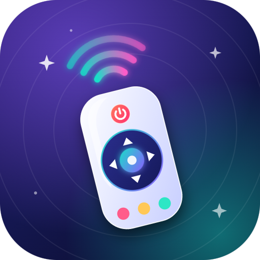

# Dianora TV Remote

<p align="center">
  
</p>

<p align="center">
  <a href="https://developer.android.com/studio"></a>
  <a href="https://developer.android.com"></a>
  <a href="#"></a>
  <a href="#"></a>
</p>

A sleek, responsive, and tactile Infrared (IR) remote control Android application engineered specifically for **Dianora Smart TVs** (MediaTek MT5862 / TP.SK518 platform).

Built with modern Android standards, tactile haptic feedback, and an ultra-responsive dark-mode interface with exact microsecond timing precision for the standard NEC 38 kHz infrared protocol.

---

## ✨ Features

- **Direct Hardware Control:** Leverages Android's native `ConsumerIrManager` to transmit modulated 38 kHz pulse sequences directly through phone IR blasters.
- **First-Run IR Hardware Verification:** Automatically detects built-in infrared hardware upon first launch:
  - If an IR blaster is present: Confirms 38 kHz frequency capability and reports active status.
  - If missing: Displays a helpful guide instructing the user to connect an external 3.5mm audio jack or USB-C infrared dongle, with instant "Check Again" verification and full simulation mode.
- **Precision NEC Encoding:** Generates exact 67-element pulse timing bursts (9ms leader, 4.5ms space, 560µs bit marks, 560µs/1690µs logical spaces, and stop bit) with zero jitter.
- **Verified Dianora IR Keymap:** Features all 32+ 2x-verified Dianora NEC codes (Address Header `0xFD02`).
- **Tactile Haptic Feedback:** Delivers micro-vibrations on every button tap for an authentic physical remote feel.
- **Hold-to-Repeat Functionality:** Long-pressing volume or channel buttons smoothly repeats commands automatically.
- **OLED Dark Mode Interface:** Energy-efficient, high-contrast UI with glowing signal confirmation and low latency.

---

## 🛠️ Hardware & Protocol Specifications

| Parameter | Specification |
| :--- | :--- |
| **Target TV Platform** | Dianora DN3201SM-V (MediaTek MT5862 / TP.SK518.PB801) |
| **Transmission Protocol** | NEC Infrared Transmission (32-bit LSB-first) |
| **Carrier Modulation** | 38,000 Hz (38 kHz), 1/3 Duty Cycle |
| **NEC Address Header** | `0xFD02` (Address Byte: `0x02`, Inverted Address: `0xFD`) |
| **Frame Structure** | `[Address: 8 bits] [~Address: 8 bits] [Command: 8 bits] [~Command: 8 bits]` |

### Keycode Map

| Key Identifier | Hex Code | Action / Description |
| :--- | :--- | :--- |
| `POWER` | `0x05` | System Power Toggle / Standby |
| `INPUT` | `0x1F` | Video Input Source (HDMI 1/2, AV, TV) |
| `MUTE` | `0x46` | Audio Mute Toggle |
| `UP` / `DOWN` | `0x48` / `0x40` | Directional Navigation & Channel Stepping |
| `LEFT` / `RIGHT`| `0x47` / `0x04` | Directional Navigation & Volume Trimming |
| `OK` | `0x44` | Confirm / Select |
| `BACK` | `0x56` | Return / Back |
| `HOME` | `0x0D` | Android TV Home Launcher |
| `MENU` | `0x5F` | TV System OSD Menu |
| `SETTINGS` | `0x27` | Quick System Settings |
| `VOL_UP` / `VOL_DOWN` | `0x17` / `0x57` | Master Volume Increase / Decrease |
| `RED` / `GREEN` | `0x05` / `0x01` | Dedicated Color Function Keys (Power / Sleep) |
| `YELLOW` / `BLUE`| `0x14` / `0x50` | Picture Mode / Sound Mode Selection |
| `0` – `9` | `0x4D`, `0x5E`, etc. | Direct Channel / Numeric Input |
| `INFO` | `0x16` | On-Screen Display Information Banner |
| `MOUSE` | `0x02` | Fly Mouse / Cursor Toggle |

---

## 📂 Project Architecture

```text
Dianora TV Remote/
├── .gitignore
├── build.gradle                 # Root Gradle configuration
├── settings.gradle              # Multi-project module configuration
├── gradle.properties            # JVM & AndroidX optimization flags
├── gradle/wrapper/              # Gradle Wrapper definition
│   └── gradle-wrapper.properties
├── app/
│   ├── build.gradle             # Application module build file
│   ├── proguard-rules.pro       # ProGuard keep rules (JavaScriptInterface)
│   └── src/main/
│       ├── AndroidManifest.xml  # Permissions and activity declarations
│       ├── java/com/firos/dianoraremote/
│       │   ├── MainActivity.java           # Main controller, WebView & onboarding
│       │   ├── IrTransmitterManager.java   # ConsumerIrManager hardware abstraction
│       │   ├── NecIrEncoder.java           # NEC 38 kHz timing generator
│       │   └── DianoraKeyMap.java          # Verified keycode registry
│       ├── assets/
│       │   └── remote.html                 # OLED remote control interface & styles
│       └── res/
│           ├── values/
│           │   ├── strings.xml  # Localized strings
│           │   ├── colors.xml   # Theme palette
│           │   └── themes.xml   # MaterialComponents dark theme
│           └── drawable/        # Vector assets & adaptive icons
└── README.md
```

---

## 🚀 How to Build Using Android Studio

1. **Clone or Open Project:**
   - Launch **Android Studio**.
   - Select **Open** and choose the `Dianora TV Remote` folder:
     ```bash
     c:\Users\firoz\Project\TV Firmware\Dianora TV Remote
     ```
2. **Sync Project with Gradle Files:**
   - Android Studio will automatically resolve Gradle dependencies (`AndroidX`, `MaterialComponents`).
3. **Run on Device:**
   - Connect an Android device (via USB Debugging or Wireless Debugging).
   - Press **Run ▶ (Shift + F10)**.

> [!TIP]
> To test without a phone that has built-in IR, you can run the app on any device or emulator. The app will welcome you and seamlessly switch to simulation mode so you can test all keys and haptic feedback.

---

## 📄 License & Credits

- **Developer:** Firos Sha Muhammad
- **Project:** Dianora Smart TV Custom Firmware & Ecosystem
- **License:** Open Source under the [MIT License](LICENSE)
